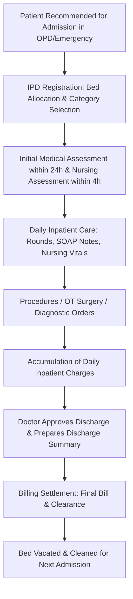

# HMS IPD (Inpatient Department) Management Skill

This skill guides the agent through the complete Inpatient care lifecycle from admission, ward/bed management, clinical care, nursing charts, to discharge processing in E-Atria HMS.

---

## 1. IPD Lifecycle Overview

---

## 2. IPD Database Architecture

| Table Name | Purpose | Key Columns |
| :--- | :--- | :--- |
| `ipd_master` | Inpatient admission record | `id`, `ipd_no`, `patient_id`, `admission_date`, `admission_time`, `r_doc_id` (admitting consultant), `bed_id`, `department_id`, `status` (`admitted`, `discharged`, `transferred`, `expired`), `discharge_date`, `discharge_time` |
| `bed_master` | Hospital bed master | `id`, `bed_name`, `bed_category_id`, `ward_id`, `is_occupied`, `daily_rate` |
| `ward_master` | Wards / departments | `id`, `ward_name`, `floor`, `total_beds` |
| `bed_assignment_history` | Bed allocation and transfer history | `id`, `ipd_id`, `patient_id`, `bed_id`, `assigned_at`, `released_at`, `transferred_reason` |
| `ipd_master_doc_list` | Multiple attending / visiting doctors assigned to an IPD case | `id`, `ipd_id`, `doc_id`, `doc_type` (`primary`, `surgeon`, `anesthetist`, `consultant`) |
| `ipd_nursing_entries` | Bedside nursing charts, TPR (Temp, Pulse, Resp), BP, SpO2, I/O chart | `id`, `ipd_id`, `nurse_id`, `entry_time`, `temp`, `pulse`, `resp_rate`, `bp_systolic`, `bp_diastolic`, `spo2`, `blood_sugar`, `intake_oral`, `intake_iv`, `output_urine`, `remarks` |
| `nursing_ipd_charges` | Inpatient consumables, nursing procedures, injections, dressing charges | `id`, `ipd_id`, `charge_name`, `qty`, `rate`, `amount`, `charged_at` |
| `ipd_discharge` | Master discharge document and final condition | `id`, `ipd_id`, `patient_id`, `discharge_type` (`normal`, `lama`, `referred`, `expired`), `discharge_status`, `follow_up_date` |
| `ipd_discharge_templates` | 7 NABH Specialty discharge summary narratives | `id`, `template_name`, `specialty`, `content_structure` |

---

## 3. Daily Clinical Rounds & Documentation (SOAP Notes)

- Every admitted patient requires at least one daily progress note by the attending doctor using the **SOAP Format**:
  - **S (Subjective)**: Patient symptoms, pain score, oral intake tolerance, night sleep.
  - **O (Objective)**: Vitals review, physical examination, wound inspection, drain output, lab results.
  - **A (Assessment)**: Clinical progress (improving, stable, deteriorating), revised differential diagnosis.
  - **P (Plan)**: Medication orders, IV fluids, lab investigation advice, discharge timeline.
- Stored in `ipd_document_templates` / `ipd_discharge_course`.

---

## 4. Bed Allocation & Ward Transfers

- **Atomic Status**: When a bed is assigned in `ipd_master`, `bed_master.is_occupied = 1` must be updated atomically within a database transaction.
- **Transfers**: When transferring a patient to another ward/bed (e.g. Ward -> ICU -> Post-Op):
  - Record release time in `bed_assignment_history` for the old bed (`bed_master.is_occupied = 0`).
  - Create a new row in `bed_assignment_history` for the new bed (`bed_master.is_occupied = 1`).
  - Update `ipd_master.bed_id` to the new bed.
  - Update room tariff in `ipd_invoice_item` starting from the transfer timestamp.

---

## 5. Discharge Workflow & Clearance

1. **Medical Discharge**: Treating doctor drafts and approves the Discharge Summary in `ipd_discharge`.
2. **Medication on Discharge**: Prescribe discharge medications with duration and explicit timing.
3. **Nursing Clearance**: Removal of IV lines, catheter, surgical dressings, return of unused pharmacy items.
4. **Billing Settlement**: Final bill audit, advance adjustment, receipt issuance (`invoice_master`).
5. **Gate Pass / Discharge Slip**: Printed with follow-up instructions and emergency contact numbers.
6. **Bed Release**: Bed marked as `is_occupied = 0` and flagged for housekeeping sanitization.
