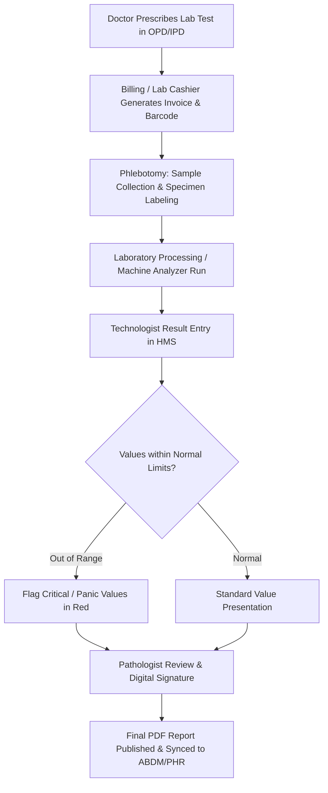

# HMS Pathology & Laboratory Management Skill

This skill guides the agent through managing clinical pathology test masters, multi-parameter panels, specimen collection, result verification, and report publication in E-Atria HMS.

---

## 1. Laboratory Data Model

| Table Name | Description | Key Fields |
| :--- | :--- | :--- |
| `investigation` | Master catalog of single lab tests and investigation profiles | `id`, `name`, `cat`, `rate`, `normal_range`, `unit`, `method`, `loinc_code`, `status` |
| `invprofiles` | Multi-test profiles (e.g., CBC, LFT, KFT, Lipid Profile, Thyroid Panel) | `id`, `profile_name`, `profile_code`, `total_rate`, `category_id` |
| `lab_tests` | Specific test parameters within a profile/department | `id`, `test_name`, `group_id`, `default_unit`, `male_min`, `male_max`, `female_min`, `female_max`, `child_min`, `child_max`, `loinc_num` |
| `lab_rgroups` | Report groups / sub-headings (e.g., Differential Leukocyte Count in CBC) | `id`, `group_name`, `dept_id`, `display_order` |
| `lab_request` | Patient lab order requisition generated from OPD/IPD | `id`, `patient_id`, `doctor_id`, `opd_id`, `ipd_id`, `order_date`, `status`, `barcode_no` |
| `lab_request_item` | Individual investigations ordered in a `lab_request` | `id`, `lab_request_id`, `investigation_id`, `status` (`pending`, `collected`, `reported`, `approved`) |
| `lab_repo` | Published test report header | `id`, `lab_request_id`, `patient_id`, `approved_by`, `report_date`, `verified_status` |
| `lab_repotests` | Recorded numerical or textual values for each parameter | `id`, `lab_repo_id`, `test_id`, `result_value`, `unit`, `reference_range`, `is_abnormal` |

---

## 2. Standard Pathology Workflow

---

## 3. Reference Ranges & Critical Values

1. **Demographic Range Splitting**:
   - Reference ranges vary by patient age and gender.
   - For CBC (Hemoglobin):
     - Adult Male: 13.0 – 17.0 g/dL
     - Adult Female: 12.0 – 15.0 g/dL
     - Infant / Child: 11.0 – 14.0 g/dL
2. **Panic / Critical Limit Alerts**:
   - Panic values (e.g. Potassium < 2.5 or > 6.5 mmol/L, Platelets < 20,000 /µL, Blood Sugar < 50 or > 450 mg/dL) must trigger immediate verbal notification to the treating physician and be flagged on the report.

---

## 4. LOINC & ABDM Diagnostics Standards

- Every test in `lab_tests` must be linked to its NRCeS/LOINC identifier (e.g., CBC Profile: `58410-2`, Fasting Blood Sugar: `1558-6`, Serum Creatinine: `2160-0`).
- Generated FHIR bundles must use `DiagnosticReport` profile:
  - `https://nrces.in/ndhm/fhir/r4/StructureDefinition/DiagnosticReportLab`
  - Observation resources for each component parameter must include LOINC coding and UCUM units (`mg/dL`, `g/dL`, `mmol/L`, `/uL`).

---

## 5. Report Header, Signatures & Printing

- Report headers must display Hospital Name, Accreditation logos (NABH/NABL if applicable), Barcode, Sample Collected Date/Time, and Report Authorized Date/Time.
- The reporting pathologist's digital signature, qualifications (MBBS, MD Path), and council registration number must appear at the bottom right.
- Patient full name must be fetched from `patient_master.p_fname`.
